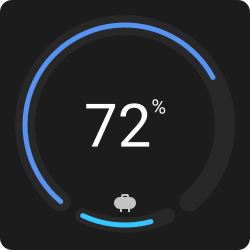
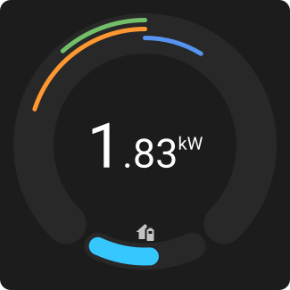

# Gauge Card

A configurable arc gauge for Home Assistant. It supports multiple stacked bars, a zero/centre origin, a centre display, condition-based colours, and an optional secondary bar with an icon. See `examples/water.yaml` and `examples/solar.yaml`.

 

## Install

Add this repository to HACS as a custom repository (type: Dashboard), or copy `dist/gauge-card.js` to `config/www` and add it as a resource.

## Development

```
npm install
npm test
npm run build   # dist/gauge-card.js
npm run dev     # open /dev/index.html for a mock-state harness
npm run docs    # regenerate the images in docs/
```

## Configuration

```yaml
type: custom:gauge-card
gauge:
  radius: 100         # track radius
  width: 20           # track width
  gap: 80             # degrees left open at the bottom
  rotation: 0         # rotates the opening clockwise
  spacing: 10         # distance between stacked bars
  linecap: round      # round | butt | square
  color: "#282828"
  color_rules: []
bars:                 # first bar is outermost
  - entity: sensor.x
    attribute: ~
    min: 0
    max: 100
    origin: min       # min | centre | <number>
    reverse: false    # flip the direction of the axis
    clamp: true
    width: 5
    color: "#5794f2"
    color_rules: []
secondary:            # fills the opening of the track
  entity: sensor.y
  padding: 10         # degrees kept free on each side
  inset: 3            # gap between bar and track edge; sets the default bar width
  width: ~            # bar width, defaults to track width - 2 x inset
  track: { width: 15, color: "#1e1e1e" }
  icon: { icon: mdi:water-pump }
  label: { size: 15, unit: "%" }
center:
  entity: sensor.x    # defaults to the first bar
  scale: 1
  decimals: 0
  rounding: floor     # floor | round
  unit: "%"
  segments:           # integer | fraction | unit | text; shift raises the text
    - { type: integer, size: 60 }
    - { type: unit, size: 20, shift: 33 }
indicators:           # icons shown while `when` holds (needs an entity)
  - icon: mdi:alert
    when: { entity: binary_sensor.z, state: "off" }
tap_action: { action: more-info }
```

Colour rules are evaluated in order and the first match wins. `when` accepts `gt`, `gte`, `lt`, `lte`, `eq`, `between`, `outside`, `state`, `state_not` and `unavailable`, optionally with `entity` and `attribute` (they default to the bar's own).

Positions of `icon`, `label` and indicators default to the middle of the track opening. Explicit `x`/`y` are offsets from the gauge centre.

The visual editor covers the gauge, bars, secondary bar and centre. Rules, indicators, icons and segments are edited in the code editor.
